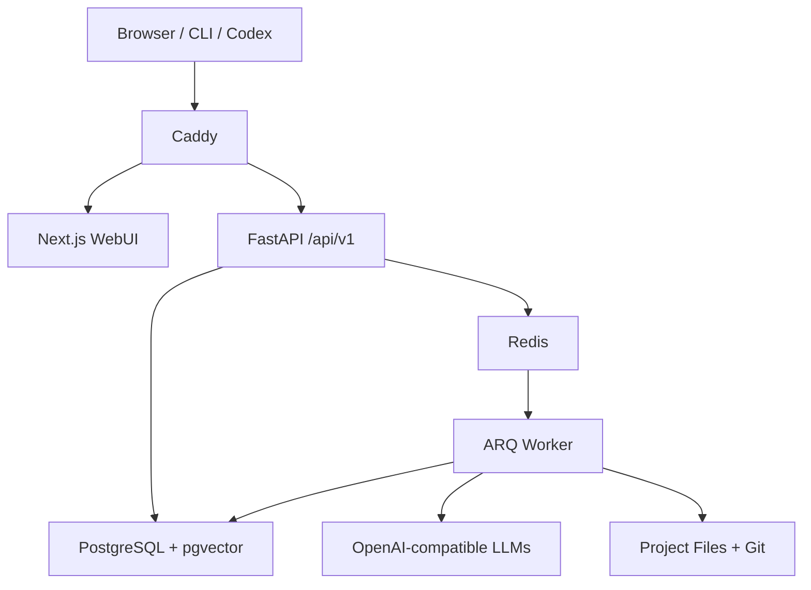
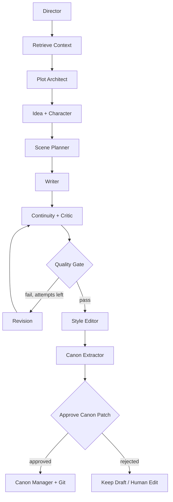

# Novel Agent Platform V0.1 开发规格

> 文档用途：直接提交给 Codex，作为首版实现的唯一需求基线。  
> 部署目标：Debian 无头服务器；**本机源码运行（native）为默认路径**，Docker Compose 为可选部署路径。浏览器/CLI/自动化 Agent 均可操作。  
> 产品定位：Headless-first、API-first、Automation-first 的多 Agent 长篇小说创作与故事状态模拟平台。  
> 修订记录：2026-09-13 运行环境修订（见 §0.1）；M0 验收命令由 Compose 改为 native 路径，Compose 保留为可选部署。

## 0. 给 Codex 的执行指令

你将从零实现本规格定义的 V0.1。先检查仓库现状、系统环境以及已有 `AGENTS.md`，不得覆盖用户已有代码或未提交改动。若仓库为空，则按本文目录初始化。

工作规则：

1. 先输出简短实施计划，再编码；按里程碑逐步完成，不要一次生成大量未经验证的代码。
2. 每完成一个里程碑，运行对应测试、修复失败，并更新 `README.md` 和 `docs/IMPLEMENTATION_STATUS.md`。
3. 所有核心逻辑必须有自动化测试；所有 UI 关键路径必须有 Playwright E2E。
4. 禁止把业务逻辑只写在前端；UI、CLI、自动化客户端必须调用同一套公开 API。
5. 禁止把密钥写入仓库；提供 `.env.example`。
6. 所有会改变正式小说状态的操作必须可追踪；自动化调试优先在 sandbox 项目中运行。
7. 如规格与实际环境冲突，先记录问题、提出最小变更方案，不得静默改变核心架构。
8. V0.1 完成前不要实现本文“未来版本”内容。

V0.1 的完成定义只有一个：

> 用户可创建小说项目、配置模型与 Preset、异步运行完整章节工作流、查看实时进度与调用轨迹、审阅/修订正文、提取并审批 Canon 变更、保存 Git 版本；Codex 可通过 API、CLI 或 Playwright 在隔离 sandbox 中复现失败。

### 0.1 运行环境修订（2026-09-13）

原基线假设目标 Debian 主机可运行 Docker Compose。实测本机（DroidSpaces Debian 13，aarch64）**没有可用的 Docker daemon**：dockerd 初始化 bridge 网络驱动失败并退出（`failed to create FILTER chain DOCKER: iptables: No chain/target/match by that name`），根因是 droidspace 的 `6.6.127-android15` 内核缺少 `bridge`/`br_netfilter` 模块且 iptables 没有 `filter` 表。这是内核能力限制，不是 user namespace 或 socket 权限问题（本机 `unshare -Ur`、`bwrap` 实测正常）。因此 M0 的 Compose 验收路径在本机不可执行，属于 §0 规则 7 所述“规格与实际环境冲突”。

最小变更方案（不改变核心架构，只改变运行方式）：

1. **默认运行方式改为 native 源码运行**：宿主机直接提供 PostgreSQL 16 + pgvector、Redis、Caddy，Python/Node 直接运行 API、worker 和前端。`Makefile` 的 `up/down/logs/migrate/health/smoke/test` 全部指向 native 路径。
2. **Compose 保留为可选部署路径**：`compose.yaml`、`compose.test.yaml`、`Caddyfile` 与 `docker compose` 相关 Makefile 目标（`compose-*`）不删除，供具备 Docker 的 Debian 主机或 CI 使用；本机不将其作为验收前提。
3. **本机版本与端口**：PostgreSQL 16.15（PGDG trixie-pgdg，含 pgvector 0.8.6）、Redis 8.0.2、Caddy 2.6.2、Python 3.12.14、Node 24.20.0。native Caddy 以非特权端口 `127.0.0.1:18080` 提供统一入口（容器内 Caddy 本身就是 8080，宿主机映射到 80；非 root 无法绑定 80）。
4. **已知环境差异**：Debian 的 `redis-server.service` 启用了 `PrivateUsers=yes`，本机 systemd 为该系统单元建立 user namespace 时失败（`Failed to set up user namespacing`，`status=217/USER`）。user namespace 本身在本机可用（`unshare -Ur`、`bwrap`、临时 `PrivateUsers` 单元均正常），因此只需为该单元写入一行 drop-in（`PrivateUsers=no`，其余 hardening 保留）即可恢复 systemd 托管；`make native-provision` 幂等完成该步骤。PostgreSQL 无需调整，直接由系统 systemd 服务管理。
5. **验收等价性**：native 路径必须提供与 Compose 相同的健康检查语义（PostgreSQL、Redis、worker heartbeat 全部正常才返回 200）、同样的 `/api/*` 与 `/` 路由，以及同样的迁移/一次性初始化顺序。

后续里程碑（M1–M6）的验收命令除非特别说明，均以 native 路径为准；`docker compose` 命令视为可选路径的等价验证。

---

## 1. 产品目标与工程宪法

### 1.1 核心对象

- **Agent**：谁在思考，以及其模型、Prompt、工具和权限。
- **Artifact**：Agent 共同读取或产生的结构化成果，如场景计划、章节草稿、质检报告和 Canon Patch。
- **Workflow**：Agent 按何种 DAG、条件和质量门协作。
- **State**：故事在某一时刻的权威状态。
- **Preset**：Agent、Workflow、模型引用、上下文策略、记忆策略和质量门的可复用组合。
- **Project**：Canon、人物、时间线、情节、章节、状态和历史的边界。

### 1.2 四条强制原则

1. Every user-visible action MUST be callable programmatically.
2. Every workflow execution MUST be observable.
3. Every failed execution SHOULD be reproducible.
4. Every destructive automation action MUST be sandboxable or reversible.

补充原则：

- 正文是故事状态变化的文学表达，而非唯一事实源。
- Agent 之间以结构化 Artifact 交接，不以无边界自然语言群聊为主要通信方式。
- Writer 不直接修改 Canon；Canon Manager 是 Canon 的唯一写入者。
- 模型与 Agent 解耦，通过 Model Registry 引用。
- 长篇采用 Rolling Planning：结局/大篇章相对稳定，未来 10 章半稳定，未来 3 章详细，下一章最详细。

---

## 2. V0.1 范围

### 2.1 必须实现

- 单用户、自托管、Tailscale/局域网访问。
- 项目创建、打开、归档；正式项目与临时 sandbox 项目隔离。
- OpenAI-compatible 模型连接，支持多个 base URL 和模型角色映射。
- YAML Preset 加载、校验、复制和项目绑定。
- 内置 `chapter_generation` 工作流。
- 异步任务队列、取消、有限重试、节点级状态和实时事件流。
- Artifact 存储、版本、依赖关系和 JSON Schema 校验。
- Canon、人物、地点、时间线、伏笔、知识状态的基础管理。
- 章节 Markdown 编辑、草稿/审定状态、人工审批 Canon Patch。
- 调用追踪：Prompt、上下文来源、模型参数、响应、耗时、Token、错误。
- Debug API、快照、隔离重放、诊断端点。
- CLI 与 WebUI 共用 API。
- WebUI 的稳定自动化定位符与 Playwright 测试。
- Git 自动提交正文和项目文件；敏感信息不得入 Git。

### 2.2 明确不做

- 多租户、公开注册、复杂 RBAC、团队实时协作。
- Kubernetes、微服务拆分、跨机器 Worker 调度。
- 可视化拖拽 DAG 编辑器（V0.1 只读图 + YAML/表单配置）。
- 完整 NPC 后台自治、经济/政治模拟。
- Git 多分支结局 UI、复杂 merge/retcon 冲突解决。
- 音频、图像生成、出版排版和移动原生应用。
- 自动将调试结论直接写回正式项目。

---

## 3. 系统架构



V0.1 使用模块化单体：`backend` 与 `worker` 共享同一 Python package；Worker 仅负责长任务。不要提前拆成多个独立业务服务。

### 3.1 技术栈

| 层 | 选择 |
| --- | --- |
| Backend | Python 3.12、FastAPI、Pydantic v2、SQLAlchemy 2、Alembic |
| Queue | Redis、ARQ |
| Database | PostgreSQL 16、pgvector |
| Frontend | Next.js、TypeScript、React、Tailwind；状态请求用 TanStack Query |
| API schema | OpenAPI 3.1；请求/响应均生成稳定 schema |
| CLI | Typer；仅作为 API client，不直连 DB |
| Testing | pytest、pytest-asyncio、Testcontainers 或 Compose test profile、Vitest、Playwright |
| Observability | JSON structured logging、SSE、Prometheus-compatible metrics（基础指标） |
| Proxy | Caddy；默认只监听 loopback 或 Tailscale 地址 |
| Deployment | Docker Compose |

### 3.2 服务

- `web`: Next.js UI。
- `api`: REST、SSE、鉴权、配置管理、同步轻操作。
- `worker`: workflow 执行、LLM 调用、检索、文件/Git 写入。
- `postgres`: 元数据、状态、事件、追踪、向量索引。
- `redis`: 队列、短期进度、分布式锁。
- `caddy`: 统一入口；`/api/*` 到 API，其余到 Web。

native 路径下同一组服务的对应关系（详见 §0.1）：

| 服务 | Compose 路径 | native 路径（本机默认） |
| --- | --- | --- |
| `web` | `frontend` 容器 | `npm run start`（Next.js standalone），`127.0.0.1:3000` |
| `api` | `api` 容器 | `.venv/bin/uvicorn novel_agent.main:app`，`127.0.0.1:8000` |
| `worker` | `worker` 容器 | `.venv/bin/python -m novel_agent.worker`（ARQ） |
| `postgres` | `pgvector/pgvector:pg16` 容器 | 系统 systemd `postgresql` 服务，`127.0.0.1:5432` |
| `redis` | `redis` 容器 | `scripts/native_ctl.sh` 托管的开发进程，`127.0.0.1:6379` |
| `caddy` | `caddy` 容器（容器内 8080，宿主映射 80） | `caddy run --config Caddyfile.native`，`127.0.0.1:18080` |
| `migrate` | 一次性 `migrate` 容器 | `make native-migrate`（Alembic + 内置 Preset bootstrap） |

---

## 4. 仓库目录

```text
novel-agent-platform/
├── AGENTS.md
├── README.md
├── compose.yaml
├── compose.test.yaml
├── Caddyfile
├── Caddyfile.native
├── .env.example
├── .env.native.example
├── Makefile
├── backend/
│   ├── pyproject.toml
│   ├── alembic.ini
│   ├── migrations/
│   ├── src/novel_agent/
│   │   ├── api/
│   │   ├── core/
│   │   ├── db/
│   │   ├── domain/
│   │   ├── agents/
│   │   ├── artifacts/
│   │   ├── workflows/
│   │   ├── providers/
│   │   ├── retrieval/
│   │   ├── tracing/
│   │   ├── projects/
│   │   └── worker/
│   └── tests/
├── frontend/
│   ├── app/
│   ├── components/
│   ├── lib/
│   └── tests/e2e/
├── cli/
│   └── novelctl/
├── presets/
│   ├── default.yaml
│   └── long_novel.yaml
├── schemas/
│   ├── artifacts/
│   └── preset.schema.json
├── prompts/
│   ├── director/
│   ├── plot_architect/
│   ├── idea/
│   ├── scene_planner/
│   ├── writer/
│   ├── continuity/
│   ├── critic/
│   ├── revision/
│   ├── style_editor/
│   └── canon_extractor/
├── projects/                 # bind mount；默认 gitignore
├── docs/
│   ├── ARCHITECTURE.md
│   ├── API.md
│   ├── ARTIFACTS.md
│   ├── AUTOMATION.md
│   ├── SECURITY.md
│   ├── DEV_ENVIRONMENT.md
│   └── IMPLEMENTATION_STATUS.md
└── scripts/
    ├── native_common.sh       # native 运行时共享变量与进程工具
    ├── native_install.sh      # venv + 依赖安装
    ├── native_build.sh        # Python 编译检查 + Next.js standalone 构建
    ├── native_provision.sh    # 幂等创建 PG 角色/数据库/pgvector
    ├── native_migrate.sh      # Alembic + 内置 Preset bootstrap
    ├── native_ctl.sh          # 启动/停止/状态：postgres 检查、redis、worker、api、web、caddy
    ├── native_smoke.sh        # native 冒烟测试
    └── compose_smoke.sh       # Compose 冒烟测试（可选路径）
```

每个小说项目的磁盘结构：

```text
projects/<project_slug>/
├── project.yaml
├── canon/
│   ├── world.md
│   ├── rules.yaml
│   └── facts.yaml
├── characters/<character_id>.yaml
├── locations/<location_id>.yaml
├── plot/
│   ├── ending.md
│   ├── arcs.yaml
│   └── rolling_plan.yaml
├── timeline/events.yaml
├── mysteries/threads.yaml
├── chapters/0001/
│   ├── brief.json
│   ├── draft.md
│   ├── final.md
│   └── summary.md
├── artifacts/
├── snapshots/
└── .git/
```

PostgreSQL 是运行元数据/查询索引的权威源；项目目录是人类可读内容和 Git 历史的权威源。写入必须通过 application service 协调，禁止 API 与 Worker 各自随意写两边。

---

## 5. 数据模型

所有主键使用 UUIDv7（若依赖不便，可用 UUID4）；所有时间为 UTC；所有记录含 `created_at`，可变记录含 `updated_at`。JSONB 字段必须配 Pydantic schema，禁止无约束 JSON 垃圾桶。

### 5.1 主要表

| 表 | 关键字段 | 说明 |
| --- | --- | --- |
| `projects` | id, slug, name, kind, status, root_path, active_preset_version_id | `kind=production/sandbox` |
| `project_snapshots` | id, project_id, git_commit, db_manifest, expires_at | 调试前快照 |
| `model_endpoints` | id, name, provider_type, base_url, secret_ref, capabilities, enabled | 不保存明文密钥 |
| `model_profiles` | id, endpoint_id, model_name, defaults, capabilities | Agent 引用的模型配置 |
| `presets` | id, name, description | Preset 身份 |
| `preset_versions` | id, preset_id, version, content_yaml, content_hash, schema_version | 不可变版本 |
| `agent_definitions` | id, preset_version_id, agent_key, model_profile_id, prompt_ref, permissions, config | 运行时 Agent 定义 |
| `workflow_definitions` | id, preset_version_id, workflow_key, dag_json, schema_version | 不可变 DAG |
| `runs` | id, project_id, workflow_key, preset_version_id, status, mode, idempotency_key, current_node, error_code | 一次执行 |
| `run_nodes` | id, run_id, node_key, attempt, status, input_artifact_ids, output_artifact_ids, started_at, ended_at | 节点实例 |
| `events` | id, sequence, project_id, run_id, node_id, actor_type, actor_id, event_type, payload | 只追加事件流 |
| `artifacts` | id, project_id, run_id, type, schema_version, status, content_json, file_path, content_hash, parent_id | 结构化交接物 |
| `artifact_edges` | source_artifact_id, target_artifact_id, relation | lineage |
| `llm_calls` | id, run_id, node_id, agent_key, model_profile_snapshot, request_json, response_json, usage_json, latency_ms, status, error | 完整可观察性 |
| `context_items` | id, project_id, kind, source_ref, text, metadata, embedding | 可检索上下文 |
| `llm_call_context` | llm_call_id, context_item_id, rank, score, reason | 记录实际检索来源 |
| `canon_entities` | id, project_id, entity_type, canonical_name, aliases, data, status | 人物/地点/物品/组织等 |
| `canon_facts` | id, project_id, subject_id, predicate, object_json, valid_from_chapter, valid_to_chapter, confidence, source_artifact_id | 时态事实 |
| `timeline_events` | id, project_id, story_time, order_key, participants, location_id, summary, source_artifact_id | 故事时间线 |
| `knowledge_states` | id, project_id, character_id, fact_id, learned_at_event_id, certainty | 信息不对称 |
| `chapters` | id, project_id, number, title, status, draft_artifact_id, final_artifact_id, git_commit | 章节索引 |
| `actions` | id, request_id, actor_type, actor_id, action_type, target_type, target_id | UI/API 操作关联 |
| `api_tokens` | id, name, token_hash, scopes, expires_at, revoked_at | 自动化 token |

### 5.2 状态枚举

- Run：`queued | running | waiting_approval | succeeded | failed | cancelled`。
- Node：`pending | running | succeeded | failed | skipped | cancelled`。
- Artifact：`draft | proposed | approved | rejected | superseded`。
- Chapter：`planned | drafting | reviewing | approved | published`。

### 5.3 并发与一致性

- 同一 production 项目默认只允许一个会修改状态的 Run；使用 PostgreSQL advisory lock 或 Redis lock。
- 所有写 API 支持 `Idempotency-Key`。
- Artifact 不原地覆盖；创建新版本并通过 `parent_id` 关联。
- Canon Patch 先 `proposed`，人工或明确配置的自动门批准后才应用。
- 文件写入采用临时文件 + 原子 rename；DB 更新和 Git 提交通过 outbox/saga 记录，不声称跨介质 ACID。

---

## 6. Artifact 契约

每个 Artifact 至少包含：

```json
{
  "artifact_id": "uuid",
  "type": "scene_brief",
  "schema_version": "1.0",
  "project_id": "uuid",
  "run_id": "uuid",
  "producer": "scene_planner",
  "content": {},
  "provenance": {
    "input_artifact_ids": [],
    "context_item_ids": [],
    "llm_call_ids": []
  }
}
```

V0.1 必须定义 JSON Schema：

- `director_decision`
- `plot_plan`
- `idea_candidates`
- `character_intent`
- `scene_brief`
- `chapter_draft`
- `continuity_report`
- `critic_report`
- `revision_instruction`
- `style_edit_result`
- `canon_patch`
- `chapter_summary`

`scene_brief.content` 最少字段：

```json
{
  "scene_id": "34-2",
  "pov_character_id": "alice",
  "location_id": "black_tower_basement",
  "objective": "寻找父亲留下的档案",
  "conflict": "发现有人先来过",
  "required_facts": ["房间没有窗", "档案编号 K19"],
  "forbidden_events": ["揭示父亲身份", "出现魔法", "角色死亡"],
  "tone": ["压抑", "安静", "逐渐不安"],
  "target_words": 1800
}
```

`critic_report` 必须提供机器可用评分与定位：

```yaml
scores:
  tension: 0.78
  pacing: 0.61
  characterization: 0.84
  prose: 0.75
  novelty: 0.53
  emotional_impact: 0.71
  continuity: 0.94
problems:
  - severity: high
    location: scene_2
    type: pacing
    description: 解释性对白过长
    evidence: "..."
    suggested_action: 压缩对白并外化冲突
```

---

## 7. Agent 设计与权限

| Agent | 职责 | 主要输出 | Canon 写权限 |
| --- | --- | --- | --- |
| Director | 决定目标、分支、是否重试/暂停 | director_decision | 无 |
| Plot Architect | 维护 rolling plan 与本章结构 | plot_plan | 无 |
| Idea Agent | 产生 safe/moderate/wild 候选 | idea_candidates | 无 |
| Character Agent | 从角色有限知识出发给出动机/反应 | character_intent | 无 |
| Scene Planner | 合并约束为精确场景简报 | scene_brief | 无 |
| Writer | 在 brief sandbox 内创作事实层正文 | chapter_draft | 无 |
| Continuity | 检查事实、时间、知识状态、人物一致性 | continuity_report | 无 |
| Critic | 量化评审节奏、张力、新颖度等 | critic_report | 无 |
| Revision | 依据具体问题修订，不擅自扩写范围 | chapter_draft 新版本 | 无 |
| Style Editor | 仅改表达，不新增/删除/改变事实 | style_edit_result | 无 |
| Canon Extractor | 从审定正文生成结构化变更提案 | canon_patch | 仅提案 |
| Canon Manager | 校验并应用已批准 Patch | canon/timeline 写入 | 唯一写入者 |

权限默认拒绝。示例：

```yaml
permissions:
  writer:
    read: [canon, scene_context, character_state, style]
    write: [artifact.chapter_draft]
  continuity:
    read: ["project:*"]
    write: [artifact.continuity_report]
  canon_manager:
    read: ["project:*"]
    write: [canon, timeline, characters, knowledge_state]
```

Style Editor 必须执行事实保护：输入 `fact_manifest`，输出时附带 `fact_diff`；检测到新增、删除或语义变化时失败并保留 Writer/Revision 原稿。

---

## 8. Chapter Generation Workflow



执行要求：

1. Retrieve Context 只取本节点所需信息，不把整个数据库塞进 Prompt。
2. Idea Agent 至少产生 10 个候选并标注风险等级、合理性、惊喜度、Canon 依赖和潜在副作用。
3. Director 必须明确选择候选及理由；不可让 Writer自行选剧情方向。
4. Writer 只接收 Scene Brief、相关人物、相关 Canon、最近上下文和 Style Guide。
5. Continuity 与 Critic 可并行，但结果必须汇合后进入 Quality Gate。
6. Revision 最多 3 次；超过后进入 `waiting_approval`，不可无限循环。
7. Style Editor 在内容审定后运行，且不得创造事实。
8. Canon Extractor 只生成 Patch；正式项目默认人工批准。
9. 成功后生成章节 Markdown、摘要、Artifact 索引和 Git commit。

### 8.1 默认质量门

```yaml
quality_gate:
  minimum:
    continuity: 0.95
    character_consistency: 0.85
    novelty: 0.65
    pacing: 0.65
  hard_fail:
    - forbidden_event_present
    - required_fact_missing
    - character_knows_unknown_fact
    - style_editor_fact_change
  revision:
    max_iterations: 3
```

质量分数是辅助，不应掩盖 hard fail。测试中使用确定性假模型验证分支，不依赖真实 LLM 的随机输出。

---

## 9. Preset 与 Model Registry

示例 `long_novel.yaml`：

```yaml
schema_version: "1.0"
name: long_novel_high_quality
planning:
  horizon:
    detailed_chapters: 3
    medium_chapters: 10
    arc_chapters: 40
context:
  recent_chapters: 3
  retrieve_top_k: 15
  token_budget: 24000
models:
  reasoning:
    model_profile_ref: cloud_reasoning
  creative:
    model_profile_ref: local_writer
  verifier:
    model_profile_ref: local_small
agents:
  director: {enabled: true, model_ref: reasoning}
  plot_architect: {enabled: true, model_ref: reasoning}
  idea: {enabled: true, model_ref: creative, candidate_count: 10}
  writer: {enabled: true, model_ref: creative}
  continuity: {enabled: true, model_ref: verifier}
  critic: {enabled: true, model_ref: reasoning}
  revision: {enabled: true, model_ref: creative}
  style_editor: {enabled: true, model_ref: creative}
  canon_extractor: {enabled: true, model_ref: verifier}
workflow_ref: chapter_generation
quality_gate:
  minimum:
    continuity: 0.95
    character_consistency: 0.85
    novelty: 0.65
  max_revision_iterations: 3
debug:
  deterministic: false
  seed: null
```

Model endpoint 配置支持：

- `base_url`
- `api_key` 的环境变量/secret reference
- `model_name`
- timeout、connect timeout、max retries
- temperature、top_p、max_tokens、seed
- capability flags：`json_schema`、`tools`、`seed`、`streaming`

Provider 适配器首版只实现 OpenAI-compatible；其他厂商必须通过同一接口扩展。启动时进行 capability probe，但失败不能导致整个 API 无法启动。

---

## 10. REST API

基础路径 `/api/v1`。错误格式统一：

```json
{
  "error": {
    "code": "RUN_ALREADY_ACTIVE",
    "message": "A mutating run is already active for this project.",
    "details": {},
    "request_id": "req_..."
  }
}
```

### 10.1 核心资源

```text
GET/POST       /projects
GET/PATCH      /projects/{project_id}
POST           /projects/{project_id}/archive
POST           /projects/{project_id}/snapshots
POST           /projects/{project_id}/snapshots/{snapshot_id}/restore

GET/POST       /presets
GET            /presets/{preset_id}/versions/{version}
POST           /presets/{preset_id}/versions
POST           /projects/{project_id}/preset:apply

GET/POST       /model-endpoints
POST           /model-endpoints/{id}:test
GET/POST       /model-profiles

GET            /projects/{project_id}/chapters
GET/PATCH      /projects/{project_id}/chapters/{chapter_number}
POST           /projects/{project_id}/chapters/{chapter_number}:approve

GET            /projects/{project_id}/artifacts
GET            /artifacts/{artifact_id}
POST           /artifacts/{artifact_id}:approve
POST           /artifacts/{artifact_id}:reject

POST           /projects/{project_id}/runs
GET            /runs/{run_id}
POST           /runs/{run_id}:cancel
POST           /runs/{run_id}:retry
GET            /runs/{run_id}/events
GET            /runs/{run_id}/events/stream
```

创建章节 Run：

```http
POST /api/v1/projects/{project_id}/runs
Idempotency-Key: <client-generated-key>
```

```json
{
  "workflow": "chapter_generation",
  "input": {"chapter_number": 12},
  "mode": "normal"
}
```

返回 HTTP 202：

```json
{
  "run_id": "run_uuid",
  "status": "queued",
  "links": {
    "self": "/api/v1/runs/run_uuid",
    "events": "/api/v1/runs/run_uuid/events/stream"
  }
}
```

### 10.2 Debug 与自动化 API

```text
GET  /health
GET  /api/v1/diagnostics
GET  /api/v1/debug/runs/{run_id}/trace
GET  /api/v1/debug/runs/{run_id}/events
GET  /api/v1/debug/runs/{run_id}/llm-calls
GET  /api/v1/debug/runs/{run_id}/context
GET  /api/v1/debug/runs/{run_id}/artifacts
GET  /api/v1/debug/runs/{run_id}/errors
POST /api/v1/debug/runs/{run_id}:replay
POST /api/v1/sandboxes
DELETE /api/v1/sandboxes/{project_id}
POST /api/v1/automation/sessions
```

`replay` 默认必须创建/使用 sandbox，不可覆盖原 Run，不可写正式项目。只有显式 `target=production` 且 scope 允许时才可触及正式项目，V0.1 UI 不提供这个入口。

`diagnostics` 检查 PostgreSQL、Redis、project filesystem、Git、Worker heartbeat 和已启用模型 endpoint；敏感信息必须脱敏。

### 10.3 鉴权

- 默认 bootstrap 创建本地管理员；生产启动禁止默认密码。
- 浏览器使用 HttpOnly、Secure（有 HTTPS 时）、SameSite=Lax session cookie。
- CLI/Agent 使用可撤销 bearer token，按 scope 控制：`project.read`、`project.write`、`run.execute`、`debug.read`、`sandbox.manage`。
- Debug API 不得暴露 provider API key、Authorization header、Cookie 或未脱敏环境变量。

---

## 11. 可观察性、事件和重放

所有链路共享：

```text
action_id → request_id → run_id → node_id → llm_call_id
```

结构化日志必须包含适用的上述字段。每次用户或 Agent 动作写入 append-only Event Log。SSE 事件至少包括：

- `run.queued`
- `run.started`
- `node.started`
- `llm_call.started`
- `llm_call.completed`
- `artifact.created`
- `quality_gate.failed`
- `node.completed`
- `run.waiting_approval`
- `run.completed`
- `run.failed`

LLM trace 保存：system/user prompt、模板版本、实际上下文、上下文来源与分数、工具调用、模型快照、采样参数、token usage、latency、原始响应、解析错误。敏感字段先脱敏再持久化。

### 11.1 Deterministic Debug Mode

- temperature=0；支持时固定 seed。
- 固定检索排序，分数相同时用稳定 ID 排序。
- 固定 Clock/UUID 的测试注入。
- 禁用并行产生的非确定性（或稳定归并输出）。
- 记录 provider/model 版本；若远端模型本身不保证确定性，在报告中明确标记 `best_effort`。
- 支持 recorded provider：用已保存的 LLM 响应进行离线重放。

重放分两类：

1. `recorded`：不调用真实模型，验证编排、解析、存储和 UI。
2. `live`：再次调用模型，比较结构、质量门和关键事实，不要求逐字相同。

---

## 12. WebUI 与自动化友好设计

### 12.1 V0.1 页面

- `/projects`：项目列表、创建、sandbox 标识。
- `/projects/[id]`：概览、当前状态、最近 Run。
- `/projects/[id]/chapters/[number]`：正文/大纲编辑器、版本、审批。
- `/projects/[id]/canon`：人物、地点、事实、时间线、待审批 Patch。
- `/projects/[id]/runs/[runId]`：节点状态、耗时、Token、输入/输出/Artifact/错误。
- `/projects/[id]/workflow`：只读 DAG 与 Preset 摘要。
- `/settings/models`：模型 endpoint/profile 测试。
- `/automation`：Token、sandbox 和 debug session。

布局可采用左侧项目树、中间编辑器、右侧 Agent/约束、底部运行活动。V0.1 优先可用性，不追求复杂视觉效果。

### 12.2 强制 UI 契约

- 所有交互元素优先用语义化 HTML、可访问名称和稳定 `data-testid`。
- `data-testid` 命名：`<resource>-<action>` 或 `<resource>-<id>-<field>`，不可包含数组位置。
- 重要实体 DOM 增加 `data-project-id`、`data-run-id`、`data-node-key`。
- 不允许 E2E 使用 `nth-child`、CSS 哈希类名或可变文本作为唯一定位。
- 每个异步动作在页面展示明确状态、`action_id`/`run_id` 和可复制错误码；不得只有 spinner。
- Toast 不作为唯一反馈；结果必须保留在 DOM 中。
- URL 查询参数 `?automation=1`：关闭动画、transition、toast 自动消失、无限滚动和非必要懒加载。
- 页面需暴露 `window.__APP_BUILD__`（仅版本/commit/schema，不含秘密）方便报告环境。

示例定位符：

```text
project-create-button
chapter-editor
chapter-save-button
generate-chapter-button
run-status
workflow-node-writer
canon-patch-approve-button
debug-trace-panel
```

---

## 13. CLI

CLI 是 API 客户端，配置保存在用户配置目录，token 不打印到日志。

```bash
novelctl health
novelctl diagnostics
novelctl project create --name "Test Novel"
novelctl project list
novelctl preset list
novelctl preset apply long_novel --project <id>
novelctl run chapter --project <id> --chapter 1 --follow
novelctl run status <run_id>
novelctl run cancel <run_id>
novelctl debug trace <run_id>
novelctl debug replay <run_id> --mode recorded
novelctl sandbox create --from-project <id>
novelctl artifact approve <artifact_id>
```

所有命令支持 `--json`；成功/业务失败/连接失败使用不同退出码。`--follow` 消费 SSE 并以节点为粒度输出进度。

---

## 14. Git 与版本策略

- 每个项目独立 Git 仓库。
- 自动提交前校验 Artifact schema、文件原子写入成功和 Canon Patch 状态。
- Commit message 示例：
  - `agent: generate chapter 0023 draft`
  - `agent: revise chapter 0023 after critic pass 2`
  - `canon: apply chapter 0023 approved patch`
  - `user: edit chapter 0023`
- Commit trailer 记录 `Run-Id`、`Action-Id`、`Artifact-Ids`。
- `.env`、API key、数据库 dump、完整 LLM secret header 不得进入项目 Git。
- V0.1 restore 只能在 sandbox 自动执行；production rollback 需要用户确认且先创建快照。

---

## 15. 安全与部署

### 15.1 网络默认值

- API、Web、数据库、Redis 不直接暴露公网。
- Caddy 默认绑定 `127.0.0.1`，部署者可显式配置 Tailscale IP。
- PostgreSQL/Redis 仅 Compose internal network。
- 若无 HTTPS，明确提示仅能在可信 Tailscale/SSH tunnel 使用。

### 15.2 文件安全

- 所有 project path 通过规范化后验证位于配置的 projects root，防止 path traversal。
- Agent 不获得任意 shell；V0.1 tools 采用 allowlist。
- Git 命令参数不可拼接 shell 字符串。
- 上传/导入限制大小和文件类型，YAML 使用 safe loader。
- Prompt 中的项目文本视为不可信数据，不得把其中指令提升为系统权限。

### 15.3 运行时与部署要求

native 路径（本机默认）：

- 只有 Caddy 绑定 loopback 端口；PostgreSQL/Redis 监听 `127.0.0.1`，不暴露公网。
- `make native-up` 必须先执行 migration 与内置 Preset bootstrap，再启动 worker、API、前端和 Caddy；启动顺序与 Compose 依赖顺序一致。
- 迁移只允许由一个受控步骤执行，不得并发迁移。
- 进程生命周期由 `scripts/native_ctl.sh` 管理（pid 文件 + 进程组信号）；`make native-down` 不删除数据，也不停止系统 PostgreSQL。
- 一键验证：`make smoke` 必须检查 `/api/health` 的 PostgreSQL、Redis、worker heartbeat 三个组件，以及占位首页和内置 Preset。
- 提供首次初始化脚本：`make native-provision` 幂等创建角色、数据库与 pgvector 扩展。

Compose 路径（可选，需目标主机具备可用 Docker daemon）：

- healthcheck、restart policy、named volumes、非 root 容器用户。
- DB migration 作为显式一次性命令或受控启动步骤；不得多个副本并发迁移。
- `docker compose up -d` 后可通过 `/health`；模型未配置时平台仍能启动并显示 diagnostics warning。
- 提供备份/恢复脚本：PostgreSQL dump + projects 目录 + 配置（不含未加密 secret）。

---

## 16. 测试策略

### 16.1 单元测试

- Preset/Artifact schema 校验。
- DAG 拓扑、条件分支、重试上限、取消传播。
- Context budget 与稳定排序。
- 权限默认拒绝、Writer 不能写 Canon。
- Style fact diff 与 hard fail。
- Canon Patch 冲突、时间有效性和角色知识状态。
- idempotency、状态机非法跃迁。

### 16.2 集成测试

- API + PostgreSQL + Redis + Worker。
- 使用 Fake/Recorded LLM provider 跑完整章节工作流。
- Worker 崩溃后任务恢复，不重复应用 Canon Patch。
- Snapshot → 修改 → Restore。
- recorded replay 产生相同 Artifact hashes（排除明确的运行元数据）。
- Git commit 与 DB 中 run/artifact 对应。

### 16.3 E2E

Playwright 必须覆盖：

1. 登录或本地 bootstrap。
2. 创建 sandbox 项目。
3. 应用 Preset。
4. 启动章节生成。
5. 查看节点实时状态。
6. 打开 Critic/Continuity 报告。
7. 审批 Canon Patch。
8. 查看最终章节与 Git 版本信息。
9. 注入 Writer 节点解析失败，页面展示错误码和 run_id。
10. 从 Debug 页面执行 recorded replay 并成功复现。

测试必须在 `?automation=1` 下运行；不得依赖真实付费模型。

### 16.4 故障注入

Fake provider 支持：timeout、429、500、malformed JSON、stream interruption、slow response。测试重试只覆盖瞬态故障；schema/权限错误不得盲重试。

---

## 17. 里程碑与 Codex 执行顺序

### M0：仓库骨架与运行环境

交付：目录、native 运行脚本（或 Compose）、API `/health`、DB migration、Redis、Worker heartbeat、Frontend 占位页、Makefile、README。

验收（native，本机默认）：

```bash
cp .env.native.example .env.native
make native-provision     # 幂等创建角色/数据库/pgvector
make native-up            # install + build + migrate + 启动 worker/api/web/caddy
curl -fsS http://127.0.0.1:18080/api/health
make smoke
```

验收（Compose，可选，需可用 Docker daemon）：

```bash
cp .env.example .env
make compose-up
curl -fsS http://127.0.0.1/api/health
```

### M1：领域模型、Project 与 Preset

交付：项目/Model Registry/Preset CRUD，YAML schema，项目目录初始化，独立 Git repo，CLI 基础。

验收：CLI 创建项目、应用 Preset；磁盘结构和 DB 索引一致；重复请求幂等。

### M2：Artifact 与 Workflow Runtime

交付：Artifact registry、DAG runner、ARQ job、Run/Node 状态机、Event Log、Fake provider、SSE。

验收：无需真实 LLM 即可完整跑一个模拟工作流；取消和失败分支可测试。

### M3：完整章节流水线

交付：所有 V0.1 Agent 契约、Prompt 模板、Context Builder、质量门、最多三次 Revision、Canon Patch 审批和 Git commit。

验收：fixture 小说可生成 chapter 1；故意制造连续性错误会进入 Revision；超限后等待人工处理。

### M4：WebUI 与 CLI 完整路径

交付：V0.1 页面、Run monitor、章节编辑器、Canon Patch 审批、Model test、CLI 全命令。

验收：浏览器和 CLI 对同一资源操作结果一致；刷新页面不丢运行状态。

### M5：Automation/Debug

交付：automation token、sandbox、snapshot、trace、recorded/live replay、diagnostics、automation UI mode、Playwright。

验收：Codex 可只凭 API 文档创建 sandbox、运行失败案例、取得 trace、recorded replay、生成含 action/request/run/node/call ID 的 bug report。

### M6：加固与部署文档

交付：安全测试、备份恢复、资源限制、日志轮转、Tailscale/SSH tunnel 部署说明、最终 OpenAPI 和操作手册。

验收：全新 Debian 主机按 README 可部署；测试全绿；无真实 secret 进入 Git；重启后任务与项目状态可恢复。

---

## 18. Definition of Done

只有同时满足下列条件才可声称 V0.1 完成：

- native 路径在目标 Debian 环境成功（`make native-up` + `make smoke`）；Compose 路径在具备可用 Docker daemon 的主机上成功。
- `/health` 正常，`/diagnostics` 可解释依赖故障。
- OpenAPI 无重复 operation ID，前端/CLI 使用同一业务 API。
- 完整章节工作流在 Fake provider 和至少一个真实 OpenAI-compatible endpoint 上通过。
- 每个 Run 可追到节点、Artifact、Context 和 LLM call。
- Canon 变更未经授权不能写入；Writer 权限测试通过。
- failed Run 可在 sandbox 使用 recorded replay 复现。
- Playwright 完成核心用户旅程，定位符稳定且启用 automation mode。
- 生产项目的破坏性操作有确认、快照或可恢复路径。
- 单元、集成、E2E 测试全绿；Lint、typecheck、migration check 全绿。
- README、架构、API、自动化、安全、备份恢复文档齐全。

---

## 19. Codex 首轮任务（可直接复制执行）

```text
请以 NOVEL_AGENT_PLATFORM_V0.1_DEVELOPMENT_SPEC.md 为唯一产品规格，实现 M0，不要提前实现 M1 之后的业务。

开始前：
1. 检查仓库、AGENTS.md、未提交改动和系统环境。
2. 输出 M0 文件级实施计划与风险。
3. 若关键版本或端口与现有项目冲突，说明后采用最小兼容调整。

M0 必须交付：
- FastAPI /health
- PostgreSQL 16 + pgvector
- Redis + ARQ worker heartbeat
- Next.js 占位首页
- Caddy 统一入口（native 非特权端口 127.0.0.1:18080；Compose 路径为宿主 80）
- native 运行路径：`.env.native.example`、`Caddyfile.native`、`scripts/native_*.sh`、`make native-provision/native-up/native-down/native-status/native-smoke`
- Compose 可选路径：healthcheck、volume、internal network、非 root 运行
- Alembic 初始 migration 基础
- .env.example、Makefile、README、docs/IMPLEMENTATION_STATUS.md、docs/DEV_ENVIRONMENT.md
- backend/frontend 的最小单元测试与 smoke test

环境说明：本机 DroidSpaces Debian 13 没有可用 Docker daemon，因此 M0 在本机的验收一律走 native 路径；Compose 文件与 `compose-*` 目标必须保留可用，但不在本机验收。

完成后必须实际执行 build、启动、health、测试与重启恢复检查；修复所有由本次改动导致的问题。最后报告：修改文件、验证命令与结果、仍存在的限制、下一步 M1 计划。不要伪造命令结果。
```

---

## 20. 未来版本方向（不进入 V0.1）

- 拖拽 Agent Graph、可分享 Preset 市场。
- 多分支故事与 Git branch 可视化。
- Retcon 影响分析与跨章节批量修复。
- NPC 自主模拟、秘密传播、政治/经济/关系状态演化。
- 多用户协作、角色级审批、审计导出。
- 多模态素材、封面/插图、出版流水线。
- 分布式推理调度，在 Debian、Max395、本地 NPU 与云 API 之间按成本/能力路由。

当这些能力进入规划时，仍应维持核心抽象：

\[
S_{t+1}=F(S_t, Actions_t, Events_t)
\]

章节是状态变迁的可读表达；State、Artifact lineage 和可复现执行记录才是系统可长期演化的基础。


# Mobile-first WebUI 增补规格

> 本节为 V0.1 强制规格。与其他 UI 描述冲突时，以本节为准。

## 1. UI 总原则：Mobile-first

Novel Agent Platform 的 WebUI 必须采用 **Mobile-first Responsive Design**。

UI 实现顺序必须是：

```text
Mobile
  ↓
Tablet
  ↓
Desktop enhancement
```

禁止采用：

```text
Desktop UI
  ↓
缩窄
  ↓
勉强适配手机
```

核心要求：

1. 所有核心用户流程必须首先在手机宽度下完整可用。
2. Desktop 不允许拥有 Mobile 无法完成的核心业务操作。
3. Desktop 可以增加同时展示的信息量、多栏布局、快捷键、悬浮面板和高级调试视图。
4. Mobile 可以通过分层页面、Drawer、Bottom Sheet、Tab、折叠区域减少同时显示的信息量。
5. UI 不得依赖 hover 才能完成操作。
6. 所有主要操作必须可以通过 touch 完成。
7. 横向滚动不得作为普通业务页面的主要导航方式。
8. 不得要求用户切换“Desktop Site”才能正常使用。

目标设备首先考虑：

- Android Chrome
- iPhone Safari
- Android WebView 类浏览器
- Tailscale 内部访问场景
- 手机远程操作 Debian Server

V0.1 不开发 Android/iOS 原生 App。

WebUI 必须能够直接作为手机端主要客户端使用。

---

# 2. Responsive Breakpoints

Tailwind 使用 Mobile-first breakpoint。

建议：

```text
default        < 640px      Mobile
sm             >= 640px     Large mobile
md             >= 768px     Tablet
lg             >= 1024px    Desktop
xl             >= 1280px    Large desktop
```

业务组件不得直接假设 viewport >= 1024px。

最低必须测试：

```text
360 × 800
390 × 844
412 × 915
768 × 1024
1440 × 900
```

其中：

```text
390 × 844
```

作为 V0.1 Mobile 主验收 viewport。

---

# 3. Mobile 信息架构

桌面端原设计：

```text
Left Sidebar
+ Main Editor
+ Right Agent Panel
+ Bottom Run Activity
```

不得直接缩放到手机。

Mobile 改为分层导航。

一级导航建议：

```text
Projects
Project
Chapter
Runs
More
```

进入 Project 后：

```text
Overview
Chapters
Canon
Runs
Workflow
Settings
```

移动端主要导航采用：

- Bottom Navigation
- 页面 Header
- Drawer
- Bottom Sheet

而不是永久显示 Sidebar。

Desktop：

```text
┌─────────────┬───────────────────────┬──────────────┐
│ Project Nav │ Main Content          │ Context      │
│             │                       │ / Agent      │
│             │                       │ / Inspector  │
└─────────────┴───────────────────────┴──────────────┘
```

Mobile：

```text
┌──────────────────────┐
│ Header               │
├──────────────────────┤
│                      │
│ Main Content         │
│                      │
├──────────────────────┤
│ Bottom Navigation    │
└──────────────────────┘
```

Agent、Artifact、Context、Debug 信息通过 Drawer / Bottom Sheet 打开。

---

# 4. Mobile Header

Mobile 页面 Header 最多保留：

```text
Back
Page title
Primary action
More
```

例如章节页面：

```text
<  Chapter 12          ⋮
```

底部固定操作区域：

```text
Save Draft
Generate / Continue
```

禁止在 390px 宽屏幕顶部堆放大量 Button。

次级操作放入：

```text
More
```

菜单。

---

# 5. Touch 交互要求

所有触控操作区域推荐不小于：

```text
44 × 44 CSS px
```

主要 CTA 推荐：

```text
height >= 44px
```

相邻危险操作之间必须保留足够距离。

例如：

```text
Approve

Reject
```

不能紧贴在一起导致误触。

删除、Restore、Apply Canon Patch 等危险操作不得通过：

```text
single accidental tap
```

直接完成。

至少需要：

```text
tap
→ confirmation
→ execute
```

---

# 6. Projects 页面

Mobile `/projects` 不使用宽表格。

使用 Card/List：

```text
My Novel
Production
Chapter 34

Last run
Succeeded · 12m ago

[ Open ]
```

Sandbox 必须有显著标识：

```text
SANDBOX
```

不得仅依赖颜色区分。

创建项目按钮 Mobile 使用：

```text
Floating Action Button
```

或者页面固定 CTA：

```text
+ New Project
```

---

# 7. Project Overview

Mobile Overview 优先显示：

```text
Project
Active Preset

Current Chapter

Latest Run
Running / Failed / Waiting Approval

Pending Canon Patches

Continue Writing
```

不要在首屏同时显示：

```text
Token
Artifact lineage
LLM calls
Git hash
完整 DAG
```

这些作为二级信息。

---

# 8. Chapter Editor

章节页面是 Mobile V0.1 的最高优先级页面之一。

Mobile 默认布局：

```text
Header

Chapter title

Tab:
[ Text ] [ Plan ] [ Review ]

Editor

Bottom Action Bar
```

Text：

```text
Markdown正文
```

Plan：

```text
Scene Brief
Plot Plan
Character Intent
```

Review：

```text
Continuity
Critic
Revision
Canon Patch
```

禁止手机同时显示：

```text
正文 + 大纲 + Agent 面板
```

三栏。

Desktop 可以变成：

```text
Outline | Editor | Inspector
```

---

# 9. Mobile 编辑器

必须支持：

- Markdown 编辑
- selection
- copy/paste
- long press
- undo/redo
- 手机软键盘
- 浏览器返回后草稿保留

编辑器打开软键盘后：

```text
Save
```

等关键操作不得永久被键盘遮挡。

必须考虑：

```text
100dvh
```

而不是单纯：

```text
100vh
```

处理 Mobile Browser 地址栏和软键盘 viewport 变化。

编辑器必须支持 autosave draft。

建议：

```text
debounce 1–3 s
```

但明确保存按钮仍然存在。

不得只依赖 autosave。

---

# 10. Run Monitor

Desktop 可以显示 DAG。

Mobile 默认不得强制缩放完整 DAG。

Mobile Run 页面首先显示纵向 Stepper：

```text
✓ Director

✓ Retrieve Context

✓ Plot Architect

✓ Idea Agent

● Writer
  running · 23s

○ Continuity

○ Critic

○ Revision
```

点击 Node：

```text
Bottom Sheet
```

展示：

```text
status
duration
model
tokens
input artifacts
output artifacts
error
trace
```

DAG 图作为：

```text
Graph
```

次级 Tab。

Mobile 可以允许 pinch zoom，但 DAG 图不能成为理解 Run 状态的唯一方式。

---

# 11. Run 实时状态

运行中页面需要保持手机可读。

顶部：

```text
Chapter 12
Generating
```

主体：

```text
Current:
Writer

Elapsed:
01:24
```

底部：

```text
[ Cancel ]
```

必须实时通过 SSE 更新。

离开页面后重新进入：

```text
GET /runs/{run_id}
```

恢复状态。

不得依赖前端内存保存执行状态。

---

# 12. Error UI

Mobile Error 必须显示：

```text
Writer failed

SCHEMA_VALIDATION_ERROR

Run:
run_xxxx

[ Copy error ]
[ View details ]
[ Replay in sandbox ]
```

禁止：

```text
Something went wrong
```

作为唯一反馈。

错误详情可以折叠。

必须允许复制：

```text
run_id
request_id
error_code
```

---

# 13. Critic / Continuity

Mobile 不使用大型横向表格。

使用：

```text
Overall

Continuity
0.94

Pacing
0.63

Novelty
0.71
```

问题采用 Card：

```text
HIGH
Pacing

Scene 2

解释性对白过长

[View evidence]
```

---

# 14. Canon

Mobile Canon 首页：

```text
Characters
Locations
Facts
Timeline
Knowledge
Pending Patches
```

每个作为独立入口。

不能直接展示巨大 Entity Table。

Character：

```text
Alice

Aliases
Role
Current state
Known facts
Relationships
History
```

信息区域使用 Accordion。

---

# 15. Canon Patch Approval

Mobile 必须特别优化 Canon Patch 审批。

展示：

```text
Chapter 12 Canon Patch

+ Alice learned K19

+ Black Tower basement
  contains archive K19

~ Alice location
  Library → Black Tower

[ View source ]
```

下方固定：

```text
Reject
Approve
```

Approve 前：

```text
Confirm Canon changes
```

Production Project 必须确认。

Sandbox 可以根据设置降低确认等级。

---

# 16. Preset UI

Mobile Preset 页面首先使用表单，不要求用户直接编辑 YAML。

例如：

```text
Preset

Planning

Detailed chapters
[ 3 ]

Medium horizon
[ 10 ]

Idea candidates
[ 10 ]

Revision limit
[ 3 ]
```

高级模式：

```text
Advanced
→ YAML
```

YAML Editor 仍必须存在。

但 YAML 不应成为 Mobile 用户配置 Preset 的唯一方法。

---

# 17. Agent 配置

Mobile：

```text
Director
Enabled

Model
cloud_reasoning

Prompt
director/default

[ Configure ]
```

点击 Configure：

```text
Full-screen sheet/page
```

编辑：

```text
Enabled
Model
Prompt
Temperature
Permissions
Agent-specific config
```

避免在一个页面塞入所有 Agent 的全部字段。

---

# 18. Model Registry

Mobile Model Endpoint 卡片：

```text
Local Qwen

http://10.x.x.x:8000/v1

Model:
qwen...

Streaming ✓
JSON Schema ✓

[Test]
```

Test 后结果不得只显示 Toast。

展示持久结果：

```text
Connection OK

Latency 214 ms

Capabilities
✓ streaming
✓ tools
✗ seed
```

---

# 19. Automation / Debug UI

虽然平台 Automation-first，但 Debug 页面也必须能在 Mobile 查看。

Trace 页面采用层级列表：

```text
Run
└ Director
   └ LLM Call
      ├ Prompt
      ├ Context
      ├ Response
      └ Usage
```

而不是要求浏览器显示宽 Trace Table。

JSON 默认：

```text
collapsed
```

支持：

```text
Copy JSON
```

和：

```text
Pretty / Raw
```

切换。

---

# 20. Bottom Sheet / Drawer 原则

Mobile 次级内容优先使用：

```text
Bottom Sheet
```

例如：

- Agent detail
- Artifact detail
- Node detail
- Context sources
- LLM parameters
- Git metadata

复杂内容则跳转独立页面。

禁止 Bottom Sheet 无限嵌套。

最多一级 Modal/Sheet。

---

# 21. Tables

所有表格必须有 Mobile alternative。

例如 Desktop：

```text
| Run | Status | Duration | Tokens |
```

Mobile：

```text
Chapter Generation

Succeeded

2m 34s
23,543 tokens
```

禁止简单设置：

```css
overflow-x: auto;
```

然后把桌面表格称为 Mobile 支持。

对于 Debug Raw Data 等天然表格/代码内容可以允许横向滚动。

---

# 22. Dialog

Mobile Dialog：

小确认：

```text
center modal
```

复杂表单：

```text
full-screen dialog
```

例如：

```text
Edit Model Endpoint
Edit Agent
Create Preset
```

Mobile 应使用近似 full-screen 页面。

---

# 23. Desktop Enhancement

Desktop >= lg 后允许启用：

- Sidebar
- Inspector
- Split Editor
- Run DAG
- Parallel Artifact panels
- Keyboard shortcuts
- Resizable panes
- Hover tooltips

这些均属于 Progressive Enhancement。

核心能力不得依赖 Desktop Enhancement。

---

# 24. Mobile 性能

移动端首屏不得加载完整：

```text
LLM trace
所有 Artifacts
完整 Canon
所有章节
完整 workflow graph
```

采用按需获取。

TanStack Query 使用独立 query key：

```text
project
chapter
run
run nodes
artifact
canon entity
```

避免 Project 页面一次获取整个项目数据。

大列表需要：

```text
pagination
```

或：

```text
load more
```

普通页面不得默认 Infinite Scroll。

原因：automation mode 要求可预测 DOM。

---

# 25. Mobile 网络条件

WebUI 必须考虑用户通过：

```text
Tailscale
Mobile network
Wi-Fi
```

访问 Debian Server。

需要：

- request timeout 明确反馈
- SSE reconnect
- retry 状态可见
- reconnect 后恢复 Run 状态
- 保存操作具备 idempotency

网络中断不得导致用户误以为 Run 已停止。

---

# 26. PWA 边界

V0.1：

可以：

```text
manifest
mobile web icon
standalone display metadata
```

但不是强制安装型 PWA。

V0.1 不实现：

- Offline chapter generation
- Service Worker 复杂缓存
- Background execution
- Push notification
- Android native app
- iOS native app

PWA 不得成为 M0–M6 完成的阻塞项。

---

# 27. Accessibility

Mobile-first 同时要求：

- Semantic HTML
- aria-label
- keyboard usable
- focus visible
- Screen Reader 基本可用
- 不依赖颜色表达唯一状态
- touch target 足够大

状态例如：

```text
FAILED
```

必须有文本。

不能只显示：

```text
红色圆点
```

---

# 28. Automation 契约

原有：

```text
?automation=1
```

继续保留。

Mobile 与 Desktop 必须使用相同：

```text
data-testid
```

例如：

```text
generate-chapter-button
```

不能出现：

```text
mobile-generate-button
desktop-generate-button
```

两个业务意义相同但自动化定位不同的元素。

若不同 breakpoint 需要不同 DOM：

至少保证同一个业务 Locator 在当前 viewport 中唯一存在。

automation mode 下：

- 禁止动画
- 禁止 transition
- Bottom Sheet 立即出现
- Toast 不自动消失
- 禁止 skeleton 无限等待
- 禁止无限滚动
- SSE 状态仍正常运行

---

# 29. Safe Area

必须支持：

```css
env(safe-area-inset-top)
env(safe-area-inset-bottom)
```

尤其：

```text
Bottom Navigation
Bottom Action Bar
```

避免被 iPhone Home Indicator 遮挡。

---

# 30. Mobile Playwright

Playwright E2E 必须新增 Mobile project。

至少：

```ts
projects: [
  {
    name: "mobile-chrome",
    use: {
      viewport: {
        width: 390,
        height: 844
      }
    }
  },

  {
    name: "desktop-chrome",
    use: {
      viewport: {
        width: 1440,
        height: 900
      }
    }
  }
]
```

可额外使用：

```text
Pixel
iPhone
```

device preset。

但 CI 主基线必须存在固定 viewport，避免 device preset 更新造成测试漂移。

---

# 31. Mobile E2E Journey

Mobile Playwright 必须完整完成：

1. 登录/bootstrap。
2. 打开 Projects。
3. 创建 sandbox project。
4. 进入 Project。
5. 应用 Preset。
6. 打开 Chapter。
7. 启动 Generate。
8. 查看 Run stepper。
9. 打开 Writer Node。
10. 查看 Critic。
11. 查看 Continuity。
12. 编辑章节。
13. 保存。
14. 查看 Canon Patch。
15. Approve Patch。
16. 查看最终 Chapter。
17. 打开 Debug Trace。
18. Recorded Replay。

不得因为 viewport 是手机而跳过核心流程。

---

# 32. Responsive E2E

必须测试 breakpoint 切换不丢失状态。

例如：

```text
打开 Chapter
→ 编辑内容
→ resize Mobile → Desktop
→ 内容仍存在
```

以及：

```text
Run running
→ resize Desktop → Mobile
→ run_id 不变
→ SSE 状态继续
```

---

# 33. Visual Regression

至少对以下 Mobile 页面保留 Screenshot Regression：

```text
Projects
Project Overview
Chapter Editor
Run Monitor
Canon Patch
Error State
```

目的不是像素级设计审美验收。

主要防止：

- overflow
- 内容遮挡
- 按钮不可见
- Bottom bar 覆盖正文
- breakpoint 崩坏

---

# 34. Frontend Component 设计

优先实现 Responsive Primitive，例如：

```text
<AppShell>
<MobileHeader>
<DesktopSidebar>
<BottomNav>
<ResponsivePanel>
<BottomSheet>
<ActionBar>
<EntityCard>
<StatusBadge>
<RunStepper>
```

禁止每个页面分别重新实现移动端适配。

---

# 35. CSS 要求

避免固定宽度：

```css
width: 800px;
```

优先：

```text
w-full
max-w-*
min-w-0
flex
grid
```

正文区域必须：

```text
min-width: 0
```

防止长文本撑破 viewport。

代码、JSON、Prompt：

```text
overflow-x-auto
```

普通 UI 不允许产生 body 横向滚动。

验收：

```js
document.documentElement.scrollWidth
<=
document.documentElement.clientWidth
```

核心页面必须成立。

---

# 36. 页面 URL 不因设备改变

不得出现：

```text
/mobile/projects
/desktop/projects
```

必须使用相同 URL：

```text
/projects
```

Responsive 行为只由 UI 层决定。

这样：

- 浏览器
- CLI reference
- Codex
- Playwright
- 用户分享 URL

获得一致资源地址。

---

# 37. Server-side / Hydration

不得根据：

```text
window.innerWidth
```

在服务器端生成完全不同业务内容。

CSS responsive 优先。

JS breakpoint 只用于：

- Dialog vs Bottom Sheet
- enhanced interaction
- graph rendering

不得影响权限或业务数据。

---

# 38. Mobile-first 对原 UI 描述的覆盖

原规格：

> 布局可采用左侧项目树、中间编辑器、右侧 Agent/约束、底部运行活动。

修订为：

> 上述布局仅作为 Desktop Enhancement。V0.1 WebUI 必须 Mobile-first。Mobile 默认采用单主内容区、Header、Bottom Navigation、Drawer/Bottom Sheet；随着 viewport 增大逐步增强为 Sidebar、多栏 Editor/Inspector 和 DAG 等桌面布局。

---

# 39. M0 增补要求

Frontend 占位页即必须：

- viewport meta 正确
- 360px 无横向溢出
- Mobile App Shell 基础建立
- Responsive layout 基础建立
- automation mode 基础建立

不得等到 M4 再开始 Mobile 适配。

---

# 40. M1–M3 UI 要求

M1 开始出现的：

```text
Project
Preset
Model
```

管理界面必须直接实现 Mobile 版本。

禁止：

```text
M1-M3 先只做桌面
M4 再重构 Mobile
```

否则容易形成不可逆的 Desktop-first component architecture。

---

# 41. M4 修订

原：

```text
M4：WebUI 与 CLI 完整路径
```

修订：

```text
M4：Mobile-first WebUI 与 CLI 完整路径
```

必须交付：

- Mobile App Shell
- Desktop Enhancement Shell
- Projects Mobile UI
- Chapter Mobile Editor
- Run Mobile Stepper
- Canon Mobile UI
- Canon Patch Mobile Approval
- Preset Mobile Form
- Model Registry Mobile UI
- Responsive Desktop layouts
- Mobile + Desktop Playwright

验收增加：

```text
390 × 844
```

viewport 下可完成完整 Chapter Generation Journey。

---

# 42. M5 修订

Automation/Debug 也必须 Mobile 可用。

必须验证：

```text
390 × 844
?automation=1
```

情况下 Codex/Playwright 可以：

- 创建 sandbox
- 启动 run
- 获取 trace
- 查看 LLM call
- replay
- 获取 error code

---

# 43. Definition of Done 增补

V0.1 不能仅因为 Desktop UI 正常而完成。

必须增加以下 DoD：

- 360px viewport 无核心页面横向 overflow。
- 390×844 可完成完整章节工作流。
- Mobile 和 Desktop 调用完全相同 API。
- Mobile 和 Desktop 使用相同业务 URL。
- 所有核心操作支持 Touch。
- 核心操作不依赖 Hover。
- Chapter Editor 可在 Mobile Browser 软键盘环境正常使用。
- Run Monitor 在 Mobile 使用 Stepper/列表即可完整理解运行状态。
- Canon Patch 可在 Mobile 完成审阅和审批。
- Debug Trace 可在 Mobile 查看。
- Mobile SSE 断线重连后 Run 状态恢复。
- Mobile Playwright E2E 全绿。
- Desktop Playwright E2E 全绿。
- Mobile 与 Desktop 的稳定 `data-testid` 契约一致。
- iPhone Safe Area 不遮挡 Bottom Navigation / Action Bar。
- Resize 不得破坏未保存编辑状态和运行监控状态。

---

# 44. 给 Codex 的额外执行规则

Codex 开发任何新 Frontend 页面前必须回答：

```text
1. 390px 下布局是什么？
2. Primary action 在哪里？
3. 次级信息如何进入？
4. 是否依赖 hover？
5. 是否出现横向 overflow？
6. Playwright 如何稳定定位？
7. Desktop 如何 progressive enhance？
```

Frontend PR/里程碑完成前至少执行：

```bash
npm run lint
npm run typecheck
npm run test

npx playwright test --project=mobile-chrome
npx playwright test --project=desktop-chrome
```

如果 Mobile 测试失败：

不得以 Desktop 测试通过作为该页面完成依据。

---

# 45. UI 优先级

V0.1 Frontend 开发优先级调整为：

```text
P0
Mobile navigation
Chapter editor
Run monitor
Approval flow
Error/debug visibility

P1
Projects
Canon
Preset
Model Registry

P2
Desktop multi-panel enhancement
DAG graph
advanced visualizations

P3
visual polish
animations
decorative effects
```

因此：

**功能可用性 > Mobile usability > automation stability > Desktop productivity enhancement > visual effects**

---

# 最终 UI 架构原则

```text
                 Same REST / SSE API
                        │
          ┌─────────────┴─────────────┐
          │                           │
     Mobile Web                  Desktop Web
          │                           │
 Single content flow          Multi-panel workspace
 Bottom navigation           Sidebar / Inspector
 Bottom Sheet                Persistent panels
 Run Stepper                 DAG + Stepper
          │                           │
          └─────────────┬─────────────┘
                        │
               Same Domain State
```

Mobile 和 Desktop 是同一个产品、同一组资源和同一套 API 的不同呈现方式，而不是两个独立前端。


